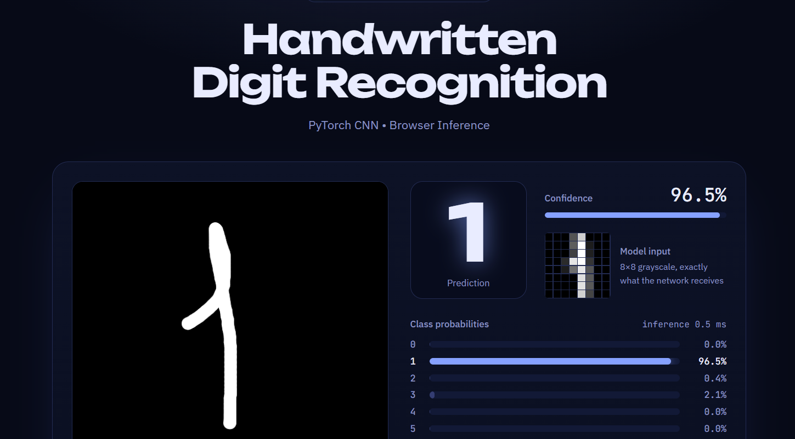

# Handwritten Digit Recognition

A CNN trained in PyTorch that recognizes handwritten digits (0–9) **live in your browser**. No server, no backend: the model runs client-side with ONNX Runtime Web.

### [▶ Try the live demo](https://shokhruxbeck.github.io/digit-recognizer/)

## Results

- **98.6% test accuracy** (355 / 360 held-out images) on scikit-learn's `load_digits`
- 6,186 trainable parameters, about 26 KB model file
- Inference in under 1 ms in the browser

## Model

Input 1×8×8 → Conv(16) + BatchNorm + ReLU → MaxPool → Conv(32) + BatchNorm + ReLU → MaxPool → Flatten (128) → Linear (10).
Trained on `sklearn.datasets.load_digits` with pixels divided by 16.

## How it works

1. **Train** the CNN in PyTorch and save the weights (`digits_cnn.pt`).
2. **Export** to ONNX (`export_to_onnx.py`) so a browser can run it.
3. **Preprocess** the drawing: the pen strokes are cropped to their bounding box, centered, redrawn at a fixed thickness and averaged down to an 8×8 grayscale grid, then scaled to the dataset's 0–16 range and divided by 16.
4. **Predict** with ONNX Runtime Web (WebAssembly) and show the softmax probabilities for all 10 classes.

### The main challenge: preprocessing

Training images are tiny, centered and use pixel values from 0 to 16. A raw canvas drawing is large, off-center and uses 0–255. A plain resize to 8×8 scored only about 20–30% in my tests. Normalizing size, position and stroke thickness fixed this. The "Model input" panel in the demo shows the exact 8×8 grid the network receives.

## Run locally

    python3 -m http.server 8000
    # open http://localhost:8000

## Files

- `index.html`, `style.css`, `app.js`: the website
- `digits_cnn.onnx`: the trained model
- `model-data.js`: the same model embedded as a fallback for opening the page from disk
- `export_to_onnx.py`: converts `digits_cnn.pt` to `digits_cnn.onnx`

## Limitations

The model was trained on 8×8 images, so very thin, messy or unusual digits can get low confidence. The demo warns when that happens.

**Tech:** PyTorch, scikit-learn, ONNX, ONNX Runtime Web, JavaScript, HTML/CSS
